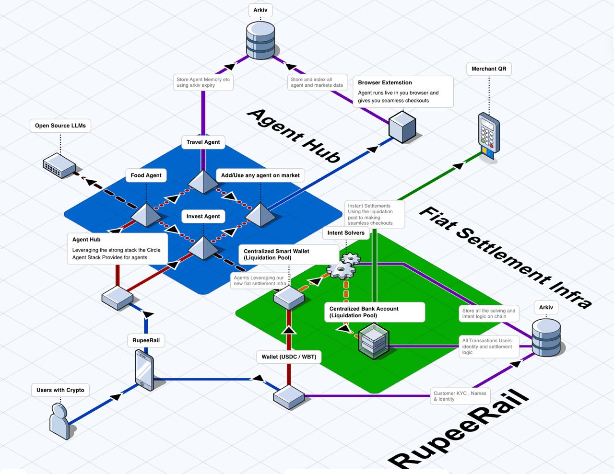
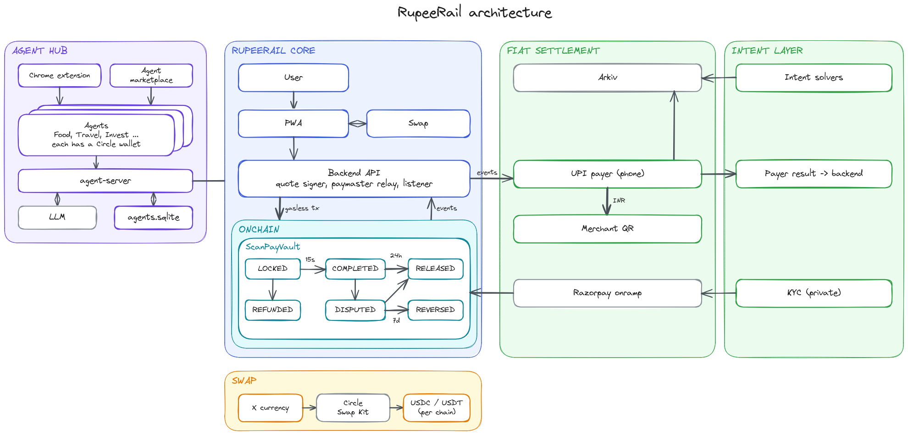
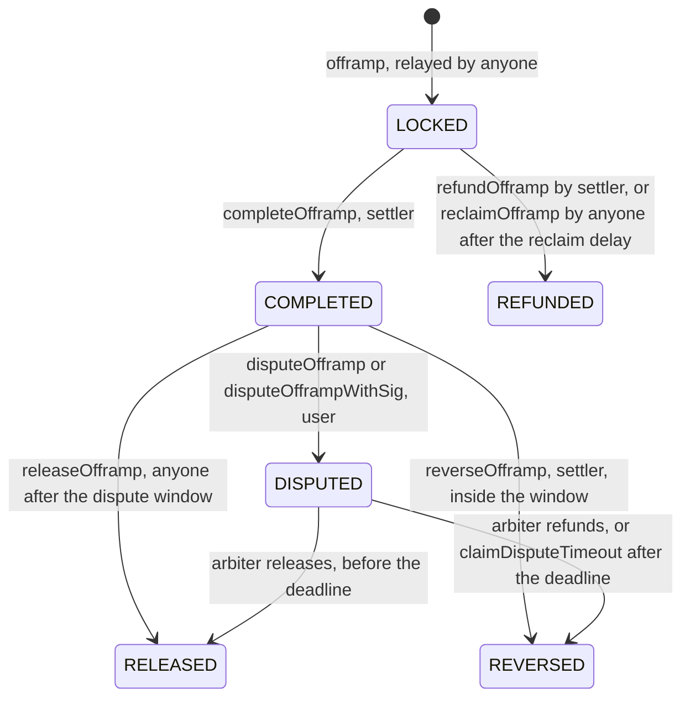

# RupeeRail

RupeeRail lets anyone holding stablecoins pay any UPI QR code in India. The payer signs in their wallet and never needs gas or an Indian bank account. The merchant receives rupees through UPI and never touches crypto. Each payment is held in an onchain escrow vault, with a dispute window the payer controls, before it settles. AI agents can pay the same way, from their own Circle smart wallets, within a budget the vault enforces.

- Web app: https://rupee-rail.indiasouthcentral.cloudapp.azure.com
- Arc Studio project: https://studio.arc.io/app/27d96855-8adb-4904-ac5a-ff15aab2f8cc

## Contract addresses

All vaults run the same [`ScanPayVault`](contracts/src/ScanPayVault.sol) contract, compiled from the Arc Studio source.

**Whitechain Sepolia (chain ID 1874)**

- Vault: [`0x326fa638bc40ebb605bedb86b990e8d3da4765c1`](https://explorer.testnet.whitechain.io/address/0x326fa638bc40ebb605bedb86b990e8d3da4765c1)
- Token (USDT): [`0xcedfB56113143d55b2358b8CFbB0dEB5Ad2f55a7`](https://explorer.testnet.whitechain.io/address/0xcedfB56113143d55b2358b8CFbB0dEB5Ad2f55a7)
- Deployment: [`0x6f9b6a33…`](https://explorer.testnet.whitechain.io/tx/0x6f9b6a336f67a3b33df51193d905fffc6051170a1502fdc563e33287c14a6b35)
- Gasless USDT payment: [lock](https://explorer.testnet.whitechain.io/tx/0x1ba850f0a739233d32ef012ee68df724fbe0a04cd2bdb6be84722d32f58e6b28), [completion](https://explorer.testnet.whitechain.io/tx/0x747bf2e55f09340cdf187fc8291a90b0f324c8931a7424bb075804a093370376), [dispute](https://explorer.testnet.whitechain.io/tx/0xfd4f056f0762fe39b5c2500702415044abc1ae8afefeb84cc15b853dbfb48965), [resolution](https://explorer.testnet.whitechain.io/tx/0xdbba4b6464b76060a21cdbed1588722a810c001fcb205f358b4a4a0099f7e820)

**Arc testnet (chain ID 5042002)**

- Vault: [`0x878734374e6131fceeeb83fa8605ab49f4d21836`](https://explorer.testnet.arc.io/address/0x878734374e6131fceeeb83fa8605ab49f4d21836)
- Token (USDC): `0x3600000000000000000000000000000000000000`
- Deployment by Arc Studio: [`0x9a277bc1…`](https://explorer.testnet.arc.io/tx/0x9a277bc17b5a4a9f3e600d7f2047a8bae5676084e80afb2f4d016a7ea731d29c)
- Payments: [from a browser wallet](https://explorer.testnet.arc.io/tx/0xd8f08ae50152e8676f35ad6704a01a7816015ddf13b3c459a6070bebd0fd5258), [from an AI agent's Circle wallet](https://explorer.testnet.arc.io/tx/0x5686e0c2edc313b89e9fac8caac7055e913c5ad7a9343ee2091b7b5363b9433f)

**Arc mainnet (chain ID 5042)**

- Vault: [`0xa140978374AAE1637b927C568E584e8fBB9a7cb0`](https://explorer.arc.io/address/0xa140978374AAE1637b927C568E584e8fBB9a7cb0)
- Token (USDC): `0x3600000000000000000000000000000000000000`
- Deployment: [`0xae833f0a…`](https://explorer.arc.io/tx/0xae833f0aa1b0a7f935bfd80a692f7cb90f7684d2c4e94b6e38661509c71c9fac)
- Funded through Circle CCTP v2 from Base: [mint on Arc](https://explorer.arc.io/tx/0x4125ece71e62a2ecce9b765f6c9d76f3c2e9ffcbbd390242ffb26623c8242018)

Roles and configuration for each chain are in [`deployments/`](deployments/).

## Why onchain settlement

UPI only works for people with an Indian bank account, and no card or remittance rail lets a stablecoin holder pay a UPI QR in seconds. Onchain settlement also gives the payer protection that the operator cannot override. The vault holds the funds while rupees go out, lets the payer dispute afterwards, refunds them if the operator never completes, and returns disputed funds if the arbiter does not decide in time.

## User flow



The payer scans a QR, and the backend returns a signed quote. The payer signs an intent and a token permit, and the RupeeRail paymaster submits them to the vault and pays the gas. Once the vault locks the funds, RupeeRail pays the merchant in rupees over UPI. The settler then completes the payment, which holds the funds through a dispute window before they are released. AI agents from the Agent Hub follow the same path, signing with their own Circle wallets.

## Architecture



- **Agent Hub:** the Chrome extension and `agent-server`, where each agent has its own Circle wallet.
- **RupeeRail core:** the PWA with Circle Swap Kit, and the backend that signs quotes, relays gasless transactions and listens for vault events.
- **Onchain:** `ScanPayVault`, the escrow and its state machine.
- **Fiat settlement:** the rupee payout to the merchant's UPI QR, and the Razorpay onramp.

## Onramp and offramp

**Offramp, stablecoin to rupees.** This is the main payment flow. The payer's USDC or USDT is locked in the vault, and the backend's payout runner hands the payment to the payout rail exactly once. The rail pays the merchant's UPI ID in rupees. The production rail is RazorpayX Payouts: each payment becomes one UPI payout with an idempotency key, so a retry cannot pay twice, and the bank's UTR becomes the payout reference recorded onchain by `completeOfframp`. If the payout fails, the payer is refunded onchain.

**Onramp, rupees to stablecoin.** A user enters a rupee amount in the web app's Buy tab and pays on a Razorpay payment link. Razorpay's callback and webhook only prompt the backend to check: the backend fetches the link from Razorpay itself and pays only if it was paid in full, in rupees, for that order. The settler then calls the vault's `onramp`, which sends stablecoins from the vault's pool to the user's wallet. Each order id can be paid only once, and onramps stay under the vault's daily cap.

The two directions share one liquidity pool. Offramp payments that pass their dispute window are released into the pool, and onramp orders are paid out of it.

## The ScanPayVault contract

**The aim.** The chain cannot see a rupee payment, so RupeeRail needs a way for a payer to trust an operator who reports one. ScanPayVault bounds that trust. The payer's funds are never handed to the operator directly. They are locked, then held through a dispute window, and every path that does not end with the funds released to the pool ends with the funds back with the payer.

**How it works.**

- **Lock.** The payer and RupeeRail's quote signer sign the same EIP-712 intent, which fixes the amount, the rupee price, a salted commitment to the QR and an expiry. Anyone can relay it, so the payer pays no gas. The vault accepts ordinary wallets and smart accounts through ERC-1271, pulls exactly the quoted amount, and fixes the payment's deadlines at that moment.
- **Complete.** Once the merchant is paid, the settler completes the payment with a unique payout reference. The funds move from escrow to held. Nobody receives them yet.
- **Dispute.** During the window the payer can dispute directly, or by a signature anyone can relay. The arbiter then refunds the payer or releases the funds. If the arbiter does not decide by the deadline, anyone can trigger a refund to the payer.
- **Release.** After the window, anyone can release undisputed funds into the pool.
- **Recover.** If the settler never completes, anyone can return the locked funds to the payer after the reclaim delay.

The vault keeps escrowed, held and pool funds in separate totals, and its balance always covers all three. Held funds can only go to the payer or the pool, never to the operator. The roles are separate: owner, settler, quote signer, arbiter and a pause-only guardian. Pausing stops new payments but never refunds, disputes or recovery.

## State machine

Every payment moves through one onchain state machine. The states are the `Status` enum in [`ScanPayVault.sol`](contracts/src/ScanPayVault.sol#L75), and every transition checks the current state first through [`_withStatus`](contracts/src/ScanPayVault.sol#L599), so no step can be repeated or skipped.



- **LOCKED:** the payer's funds are in escrow while the rupee payout happens.
- **COMPLETED:** the payout was reported, and the funds are held through the dispute window.
- **DISPUTED:** the payer objected, and the funds are frozen until the arbiter decides or the deadline passes.
- **RELEASED:** the funds moved into the pool, which ends the payment.
- **REVERSED** and **REFUNDED:** the funds went back to the payer, which ends the payment.

The backend mirrors these states, and its keepers call the permissionless transitions (reclaim, release and dispute timeout) when they fall due. AI agents run a separate state machine in [`agent-server/app/machine.py`](agent-server/app/machine.py), which decides in code when checkout is reached and only then lets the agent's wallet sign.

## Arc Studio and Circle

- **Arc Studio** wrote the contract, its deploy scripts and its Foundry test suite, ran a security review, and deployed the Arc testnet vault. `.arc-studio/pull-manifest.json` holds the hash of each pulled file, proving `contracts/` is unedited Studio output. Studio also built the web app's EURC to USDC swap feature, recorded in `.arc-studio/web-swap.json`.
- **Arc** uses USDC as gas, so the paymaster's costs and revenue are in the same stablecoin.
- **Circle Swap Kit** lets a payer on Arc swap EURC to USDC in their own wallet when their USDC balance is short.
- **Circle agent wallets** (Circle CLI) give each AI agent its own smart account. Each wallet approves the vault for a capped amount, so the allowance is the agent's onchain budget, and a running agent can only sign.
- **Circle CCTP v2 and the Forwarding Service** bridged USDC from Base to fund the Arc mainnet deployment.

## Whitechain

The Whitechain vault settles in the official test USDT, whose EIP-2612 permit lets the payer pay with two signatures and no transaction. The RupeeRail paymaster is a hot wallet that the company funds with WBT, and the spread on each quote covers its gas. It cannot be drained:

- It relays only intents that match an unused, unexpired quote the backend signed itself.
- It verifies the user's signature, permit or allowance, and balance before sending.
- It simulates every transaction before broadcasting, so failing transactions never cost gas.
- It enforces per-payment and daily per-user limits and an API rate limit, on top of the vault's onchain cap.

## Arkiv: public agent track records

Agents that opt in publish a public record to Arkiv on Rabdi (chain 7794095): a card, a read-only receipt for each payment, and a marker while they're working. [The Agents page](https://rupee-rail.indiasouthcentral.cloudapp.azure.com/agents) reads these from Arkiv, needs no wallet, and updates live.

**Writer wallet:** [`0xa0B88fd138CC23394091F46A64AAc4e38eA4Dd8c`](https://rabdi.explorer.arkiv.network/address/0xa0B88fd138CC23394091F46A64AAc4e38eA4Dd8c), which creates every entity.

**One query you can run**, with a free [access key](https://hub.arkiv.network/access-keys) and Node 22.10 or later. It needs no RupeeRail server:

```bash
cd services/arkiv-board && npm ci
ARKIV_ACCESS_KEY=<your key> npm run verify -- 0x179dfbC07B23541849a2Cb6D38d991D9Ec7Cda88
```

That runs this query, among others:

```ts
select().from(Receipt).createdBy("0xa0B88fd138CC23394091F46A64AAc4e38eA4Dd8c")
  .where(eq("wallet", addr("0x179dfbC07B23541849a2Cb6D38d991D9Ec7Cda88"))).orderBy(desc("finishedAt"))
```

Details: [schema](arkiv/schema.md), [why Arkiv](arkiv/why-arkiv.md), [how we use it](arkiv/how-you-use-arkiv.md), [reach](arkiv/reach.md), [friction](arkiv/friction.md).

## How AI was used

This project was built with Claude Code, which wrote much of the code under the team's direction, and the team reviewed and tested the results. At run time, agents use a vision model through an OpenAI-compatible API to choose page actions. The model can't cause a payment: plain code decides when a checkout is reached and checks every quote.

## Tech stack

- **Contract:** Solidity, Foundry and OpenZeppelin, in Arc Studio
- **Backend:** Python, FastAPI, web3.py and SQLite
- **Web app:** React, Vite and MUI as a PWA, with EIP-1193 and EIP-6963 wallets and Circle Swap Kit
- **Payments in and out:** Razorpay payment links for the onramp, RazorpayX Payouts for the offramp
- **Agents:** a Chrome extension and a Python state machine, with a vision model through an OpenAI-compatible API and Circle CLI wallets
- **Hosting:** an Azure VM with Caddy

## Setup

```bash
git submodule update --init --recursive
cd contracts && forge test
cd services/api-py && WORKERS=0 uv run uvicorn app.main:app --port 8788
cd apps/web && npm install && npm run dev
```

Each component's README has full details.

## License

MIT. See [`LICENSE`](LICENSE).
